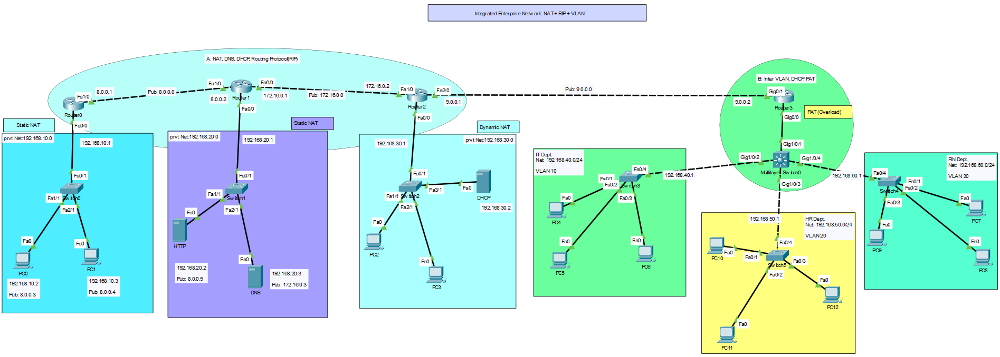

# Integrated Enterprise Network (Cisco Packet Tracer)

Two separately built networks joined into one working enterprise network:

- **[Network A](network-a/README.md):** three NAT-edge routers, DHCP, DNS, HTTP and RIP v2.
- **[Network B](network-b/README.md):** three department VLANs with inter-VLAN routing (router-on-a-stick) and DHCP.

One routed link connects them, and users in the VLANs can browse `http://www.visit.com`, which is hosted in Network A.



Built from two standalone labs: [Network A](network-a/) and [Network B](network-b/).

## Key points

1. **RIP carries public networks only.** The `192.168.x.0` LANs are private and hidden behind NAT, so they are never advertised.
2. **Router3 is a NAT edge, like the Network A routers.** `Gig0/1` is NAT outside, the three VLAN subinterfaces are NAT inside, and PAT (overload) shares `9.0.0.2` for every VLAN host.
3. **The Router2 to Router3 link (**`9.0.0.0/30`**) has no NAT flags.** Traffic crossing it keeps its addresses.
4. **VLAN clients use DNS** `172.16.0.3` (the DNS server's public NAT address). Router3 does not run DNS, so its DHCP pools must hand out this address.
5. **The DNS record for** `www.visit.com` **must point to** `8.0.0.5`**,** the HTTP server's public address. A private address is unreachable from Network B.
6. **After changing a DHCP pool, renew the lease on each PC.** Old leases keep the old DNS server.
7. **Run** `write` **on every router and switch,** and always before adding hardware or powering a device off. Unsaved configuration is lost.
8. **Traffic is outbound-only for the VLANs.** VLAN hosts can reach Network A, but Network A cannot start connections to VLAN hosts because PAT hides them.


## How it works

What happens when a VLAN PC opens `http://www.visit.com`:

1. **DHCP:** the PC broadcasts. Router3's pool for that VLAN answers with an address, the gateway (the VLAN's subinterface) and DNS `172.16.0.3`.
2. **DNS query:** the PC sends it to its gateway. Router3 routes it out `Gig0/1` and PAT rewrites the source to `9.0.0.2`.
3. **Across the link:** Router2 forwards it untouched (no NAT on `Fa2/0`). RIP gave Router2 and Router1 the routes they need.
4. **Static NAT on Router1:** the public address `172.16.0.3` is translated to the real DNS server `192.168.20.3`. The answer is `8.0.0.5`, and the reply returns to `9.0.0.2`.
5. **HTTP request:** the PC asks for `8.0.0.5`. Router1's static NAT delivers it to the HTTP server `192.168.20.2`.
6. **Return path:** the page goes back to `9.0.0.2`, and Router3's PAT table maps it to the right VLAN PC.


## Topology

```text
 Network A (public chain, RIP v2)                              Network B (VLAN campus)

 Router0 --- 8.0.0.0/24 --- Router1 --- 172.16.0.0/16 --- Router2 --- 9.0.0.0/30 --- Router3
   |                          |                             |                          |
 192.168.10.0/24        192.168.20.0/24                192.168.30.0/24       Multilayer Switch0 (trunks)
 PC0, PC1               HTTP, DNS servers              PC2, PC3, DHCP          |        |        |
 (static NAT)           (static NAT)                   (dynamic NAT)       IT VLAN10  HR VLAN20  FIN VLAN30
                                                                          .40.0/24   .50.0/24   .60.0/24
```


## Addressing


| Router  | Interface | Address         | Role                        |
| ------- | --------- | --------------- | --------------------------- |
| Router0 | Fa0/0     | 192.168.10.1/24 | NAT inside                  |
| Router0 | Fa1/0     | 8.0.0.1/24      | NAT outside                 |
| Router1 | Fa0/0     | 192.168.20.1/24 | NAT inside                  |
| Router1 | Fa1/0     | 8.0.0.2/24      | NAT outside                 |
| Router1 | Fa6/0     | 172.16.0.1/16   | NAT outside                 |
| Router2 | Fa0/0     | 192.168.30.1/24 | NAT inside                  |
| Router2 | Fa1/0     | 172.16.0.2/16   | NAT outside                 |
| Router2 | Fa2/0     | 9.0.0.1/30      | Link to Router3 (no NAT)    |
| Router3 | Gig0/1    | 9.0.0.2/30      | NAT outside                 |
| Router3 | Gig0/0.10 | 192.168.40.1/24 | VLAN 10 gateway, NAT inside |
| Router3 | Gig0/0.20 | 192.168.50.1/24 | VLAN 20 gateway, NAT inside |
| Router3 | Gig0/0.30 | 192.168.60.1/24 | VLAN 30 gateway, NAT inside |


| Static NAT: private | Public     | Host        |
| ------------------- | ---------- | ----------- |
| 192.168.10.2        | 8.0.0.3    | PC0         |
| 192.168.10.3        | 8.0.0.4    | PC1         |
| 192.168.20.2        | 8.0.0.5    | HTTP server |
| 192.168.20.3        | 172.16.0.3 | DNS server  |


Other NAT: Router2 uses dynamic NAT with pool `172.16.0.4` to `172.16.0.10` for `192.168.30.0/24`. Router3 uses PAT on `Gig0/1` for `192.168.40.0/24`, `192.168.50.0/24` and `192.168.60.0/24`.


| Department | VLAN | Network         | Switch  |
| ---------- | ---- | --------------- | ------- |
| IT         | 10   | 192.168.40.0/24 | Switch3 |
| HR         | 20   | 192.168.50.0/24 | Switch5 |
| FIN        | 30   | 192.168.60.0/24 | Switch4 |


## How to build it

1. **Build and test Network A:** [network-a/README.md](network-a/README.md)
2. **Build and test Network B:** [network-b/README.md](network-b/README.md)
3. **Join them:** the integration steps below.


## Integration steps


### Step 1: Add an interface (Fa2/0) to Router2 and connect the networks

Connect Router2 `Fa2/0` to Router3 `Gig0/1`.

### Step 2: Configure Router2

Give the new interface an address and advertise it in RIP. It gets no NAT command.

```text
en
conf t
! New link toward Router3
int fa2/0
ip address 9.0.0.1 255.255.255.252
no shut
exit
! RIP: add the link network so the other routers learn it
router rip
network 9.0.0.0
end
write
```


### Step 3: Configure Router3

Make Router3 a NAT edge: the link is outside, the VLAN subinterfaces are inside.

```text
en
conf t
! Link toward Router2 = NAT outside
int gig0/1
ip address 9.0.0.2 255.255.255.252
ip nat outside
no shut
exit

! VLAN gateways = NAT inside
int gig0/0.10
ip nat inside
exit
int gig0/0.20
ip nat inside
exit
int gig0/0.30
ip nat inside
exit

! ACL: which private networks may be translated
access-list 1 permit 192.168.40.0 0.0.0.255
access-list 1 permit 192.168.50.0 0.0.0.255
access-list 1 permit 192.168.60.0 0.0.0.255
! PAT: all of them share the address of gig0/1 (overload)
ip nat inside source list 1 interface gig0/1 overload

! RIP: advertise only the link network (never the 192.168.x LANs)
router rip
version 2
network 9.0.0.0
end
write
```


### Step 4: Point the VLAN clients at the real DNS server

```text
en
conf t
! DHCP pools now hand out the DNS server's public NAT address
ip dhcp pool IT-Pool
dns-server 172.16.0.3
exit
ip dhcp pool HR-Pool
dns-server 172.16.0.3
exit
ip dhcp pool FIN-Pool
dns-server 172.16.0.3
exit
end
write
```

Then renew each VLAN PC's lease: run `ipconfig /release` and `ipconfig /renew` in its Command Prompt, or switch it to Static and back to DHCP. `ipconfig /all` should show DNS `172.16.0.3`.

### Step 5: Check the DNS record

On the DNS server (Services > DNS), `www.visit.com` must point to `8.0.0.5`.

### Step 6: Test

Follow the verification table, shortest trip first. If a step fails, fix it before moving on. A failure usually shows as a missing route in `show ip route`.

## Final configurations

Router2 (complete)

```text
en
conf t
int fa0/0
ip address 192.168.30.1 255.255.255.0
ip nat inside
no shut
exit
int fa1/0
ip address 172.16.0.2 255.255.0.0
ip nat outside
no shut
exit
int fa2/0
ip address 9.0.0.1 255.255.255.252
no shut
exit
access-list 1 permit 192.168.30.0 0.0.0.255
ip nat pool 1 172.16.0.4 172.16.0.10 netmask 255.255.0.0
ip nat inside source list 1 pool 1
router rip
version 2
network 172.16.0.0
network 9.0.0.0
end
write
```

Router3 (complete)

```text
en
conf t
! Inter-VLAN routing (router-on-a-stick)
int gig0/0
no shut
exit
int gig0/0.10
encapsulation dot1Q 10
ip address 192.168.40.1 255.255.255.0
ip nat inside
exit
int gig0/0.20
encapsulation dot1Q 20
ip address 192.168.50.1 255.255.255.0
ip nat inside
exit
int gig0/0.30
encapsulation dot1Q 30
ip address 192.168.60.1 255.255.255.0
ip nat inside
exit

! DHCP
ip dhcp excluded-address 192.168.40.1 192.168.40.10
ip dhcp excluded-address 192.168.50.1 192.168.50.10
ip dhcp excluded-address 192.168.60.1 192.168.60.10
service dhcp
ip dhcp pool IT-Pool
network 192.168.40.0 255.255.255.0
default-router 192.168.40.1
dns-server 172.16.0.3
exit
ip dhcp pool HR-Pool
network 192.168.50.0 255.255.255.0
default-router 192.168.50.1
dns-server 172.16.0.3
exit
ip dhcp pool FIN-Pool
network 192.168.60.0 255.255.255.0
default-router 192.168.60.1
dns-server 172.16.0.3
exit

! Link to Router2 and PAT
int gig0/1
ip address 9.0.0.2 255.255.255.252
ip nat outside
no shut
exit
access-list 1 permit 192.168.40.0 0.0.0.255
access-list 1 permit 192.168.50.0 0.0.0.255
access-list 1 permit 192.168.60.0 0.0.0.255
ip nat inside source list 1 interface gig0/1 overload

! Routing
router rip
version 2
network 9.0.0.0
end
write
```

Router0, Router1 and the switches keep the configurations from the Network A and Network B guides.

## Verification

Wait about 30 seconds for RIP to converge.


| Test              | Command or action                                | Expected result                           |
| ----------------- | ------------------------------------------------ | ----------------------------------------- |
| Link              | `ping 9.0.0.2` from Router2                      | Replies                                   |
| Routes on Router3 | `show ip route`                                  | RIP routes for `8.0.0.0` and `172.16.0.0` |
| Routes on Router0 | `show ip route`                                  | RIP route for `9.0.0.0`                   |
| VLAN DHCP         | `ipconfig /all` on a VLAN PC                     | VLAN-range address, DNS `172.16.0.3`      |
| DNS server        | `ping 172.16.0.3` from a VLAN PC                 | Replies                                   |
| HTTP server       | `ping 8.0.0.5` from a VLAN PC                    | Replies                                   |
| Network A PC      | `ping 8.0.0.3` from a VLAN PC                    | Replies                                   |
| Name resolution   | `nslookup www.visit.com`                         | Returns `8.0.0.5`                         |
| Web               | Open `http://www.visit.com` in a VLAN PC browser | Page loads                                |
| PAT               | `show ip nat translations` on Router3            | VLAN hosts translated to `9.0.0.2`        |


Run the VLAN tests from one PC in each department (IT, HR, FIN).

## Problems faced and fixes


| Problem                                                   | Cause                                                                        | Fix                                                  |
| --------------------------------------------------------- | ---------------------------------------------------------------------------- | ---------------------------------------------------- |
| VLAN PCs could not resolve `www.visit.com`                | The DHCP pools gave the router's own address as DNS, and Router3 runs no DNS | Set `dns-server 172.16.0.3` in each pool             |
| PCs still used the old DNS server after the fix           | They held old DHCP leases                                                    | Renewed the lease on each PC                         |
| Router2's links turned red after adding the new interface | Router2 had to be powered off, and its unsaved configuration was wiped       | Re-entered the Router2 configuration and ran `write` |


## Repository structure

```text
.
├── README.md
├── integrated/
│   └── integrated-enterprise-network.pkt
├── network-a/
│   ├── README.md
│   └── network-a.pkt
├── network-b/
│   ├── README.md
│   └── network-b.pkt
└── images/
    ├── topology-integrated.png
    ├── topology-network-a.png
    └── topology-network-b.png
```

