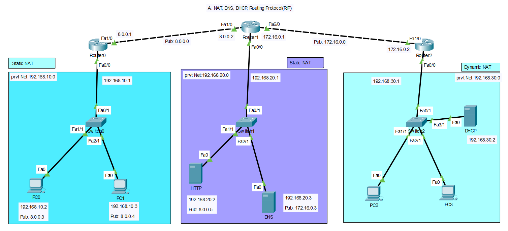

# Network A: NAT, DNS, DHCP and RIP (Cisco Packet Tracer)

Three routers in a chain, each guarding a private LAN with NAT. The routers share their public networks using RIP v2. A DNS server, an HTTP server and a DHCP server run inside the private LANs.

This is a standalone lab and the first half of the [integrated enterprise network](../README.md).



## Key points

1. **Private LANs are hidden behind NAT.** Only the public networks `8.0.0.0` and `172.16.0.0` go into RIP.
2. **Every NAT router needs inside and outside interfaces.** LAN side is `ip nat inside`, public side is `ip nat outside`. Without both, nothing is translated.
3. **Two kinds of NAT are used.** Static NAT gives a host a fixed public address (Router0, Router1). Dynamic NAT hands out addresses from a pool (Router2).
4. **Hosts reach each other through their public addresses** (for example `ping 8.0.0.5` for the HTTP server).
5. **The DNS record must hold the public address** (`8.0.0.5`), not the private one.
6. **Run `write` on each router** after configuring it.

## How it works

1. **Addressing:** each router gets a private LAN interface and a public interface.
2. **NAT:** when a packet leaves a LAN, the router rewrites the private source address to a public one. Router0 and Router1 use fixed mappings. Router2 picks an address from its pool (`172.16.0.4` to `172.16.0.10`).
3. **RIP v2:** the routers tell each other which public networks they can reach, so every router knows how to forward traffic to the others.
4. **Return traffic:** replies come back to the public address, and the NAT router translates it back to the private host.
5. **Example:** PC2 (192.168.30.x) asks the DNS server (public `172.16.0.3`) for `www.visit.com`. Router2 translates PC2's address, Router1 translates `172.16.0.3` to the real DNS server `192.168.20.3`, and the answer is `8.0.0.5`. PC2 then reaches the HTTP server the same way.

## Topology

```text
Router0 --- 8.0.0.0/24 --- Router1 --- 172.16.0.0/16 --- Router2
   |                          |                            |
Switch0                    Switch1                      Switch2
PC0, PC1                   HTTP, DNS                    PC2, PC3, DHCP
192.168.10.0/24            192.168.20.0/24              192.168.30.0/24
(static NAT)               (static NAT)                 (dynamic NAT)
```

## Connections

| From | To |
| --- | --- |
| Router0 Fa0/0 | Switch0 Fa0/1 |
| Switch0 Fa1/1, Fa2/1 | PC0, PC1 |
| Router0 Fa1/0 | Router1 Fa1/0 |
| Router1 Fa0/0 | Switch1 Fa0/1 |
| Switch1 Fa1/1, Fa2/1 | HTTP server, DNS server |
| Router1 Fa6/0 | Router2 Fa1/0 |
| Router2 Fa0/0 | Switch2 Fa0/1 |
| Switch2 Fa1/1, Fa2/1, Fa3/1 | PC2, PC3, DHCP server |

The switches stay at their default configuration.

## Addressing

| Router | Interface | Address | NAT role |
| --- | --- | --- | --- |
| Router0 | Fa0/0 | 192.168.10.1/24 | inside |
| Router0 | Fa1/0 | 8.0.0.1/24 | outside |
| Router1 | Fa0/0 | 192.168.20.1/24 | inside |
| Router1 | Fa1/0 | 8.0.0.2/24 | outside |
| Router1 | Fa6/0 | 172.16.0.1/16 | outside |
| Router2 | Fa0/0 | 192.168.30.1/24 | inside |
| Router2 | Fa1/0 | 172.16.0.2/16 | outside |

| Host | Private address | Gateway | Public address (NAT) |
| --- | --- | --- | --- |
| PC0 | 192.168.10.2/24 | 192.168.10.1 | 8.0.0.3 |
| PC1 | 192.168.10.3/24 | 192.168.10.1 | 8.0.0.4 |
| HTTP server | 192.168.20.2/24 | 192.168.20.1 | 8.0.0.5 |
| DNS server | 192.168.20.3/24 | 192.168.20.1 | 172.16.0.3 |
| DHCP server | 192.168.30.2/24 | 192.168.30.1 | - |
| PC2, PC3 | from DHCP | 192.168.30.1 | from the pool (172.16.0.4 to 172.16.0.10) |

Set PC0 and PC1 with DNS server `172.16.0.3`. PC2 and PC3 get DNS from the DHCP server.

## Build steps

### Step 1: Place devices, connect them and set host addresses

Use the connections table. Set PC0, PC1, the HTTP server, the DNS server and the DHCP server to the static addresses above (Desktop > IP Configuration). Leave PC2 and PC3 on DHCP.

### Step 2: Configure Router0

```text
en
conf t
! LAN side: gateway for PC0 and PC1, marked NAT inside
int fa0/0
ip address 192.168.10.1 255.255.255.0
ip nat inside
no shut
exit
! Public side: link to Router1, marked NAT outside
int fa1/0
ip address 8.0.0.1 255.255.255.0
ip nat outside
no shut
exit
! Static NAT: one fixed public address per host
ip nat inside source static 192.168.10.2 8.0.0.3
ip nat inside source static 192.168.10.3 8.0.0.4
! RIP v2: advertise the public network only
router rip
version 2
network 8.0.0.0
end
write
```

### Step 3: Configure Router1

```text
en
conf t
! LAN side: gateway for the HTTP and DNS servers
int fa0/0
ip address 192.168.20.1 255.255.255.0
ip nat inside
no shut
exit
! Public side toward Router0
int fa1/0
ip address 8.0.0.2 255.255.255.0
ip nat outside
no shut
exit
! Public side toward Router2
int fa6/0
ip address 172.16.0.1 255.255.0.0
ip nat outside
no shut
exit
! Static NAT for the two servers
ip nat inside source static 192.168.20.2 8.0.0.5
ip nat inside source static 192.168.20.3 172.16.0.3
! RIP v2: advertise both public networks
router rip
version 2
network 8.0.0.0
network 172.16.0.0
end
write
```

### Step 4: Configure Router2

```text
en
conf t
! LAN side: gateway for PC2, PC3 and the DHCP server
int fa0/0
ip address 192.168.30.1 255.255.255.0
ip nat inside
no shut
exit
! Public side toward Router1
int fa1/0
ip address 172.16.0.2 255.255.0.0
ip nat outside
no shut
exit
! ACL: which private addresses may be translated
access-list 1 permit 192.168.30.0 0.0.0.255
! Pool: which public addresses they receive
ip nat pool 1 172.16.0.4 172.16.0.10 netmask 255.255.0.0
! Dynamic NAT: bind the ACL to the pool
ip nat inside source list 1 pool 1
! RIP v2: advertise the public network only
router rip
version 2
network 172.16.0.0
end
write
```

### Step 5: Configure the servers

- **DNS server** (Services > DNS): turn it **On** and add an A record, name `www.visit.com`, address `8.0.0.5`.
- **HTTP server** (Services > HTTP): make sure HTTP is **On**.
- **DHCP server** (Services > DHCP): turn it **On** and set the pool with gateway `192.168.30.1`, DNS `172.16.0.3`, start address `192.168.30.10`, mask `255.255.255.0` and 50 users. Save it, then set PC2 and PC3 to DHCP.

### Step 6: Test

Wait about 30 seconds for RIP, then use the table below.

## Verification

| Test | Command or action | Expected result |
| --- | --- | --- |
| RIP routes | `show ip route` on Router0 | Learned (`R`) route to `172.16.0.0/16` |
| RIP routes | `show ip route` on Router2 | Learned (`R`) route to `8.0.0.0/24` |
| Static NAT | `show ip nat translations` on Router0 | Entries for `192.168.10.2` and `192.168.10.3` |
| Dynamic NAT | PC3 pings `8.0.0.5`, then `show ip nat translations` on Router2 | Entry from the `172.16.0.4` to `172.16.0.10` pool |
| NAT counters | `show ip nat statistics` | Hits increase as traffic flows |
| DHCP | PC2 gets an address | `192.168.30.x`, gateway `192.168.30.1` |
| DNS and HTTP | PC0 or PC2 opens `http://www.visit.com` | Page loads |
