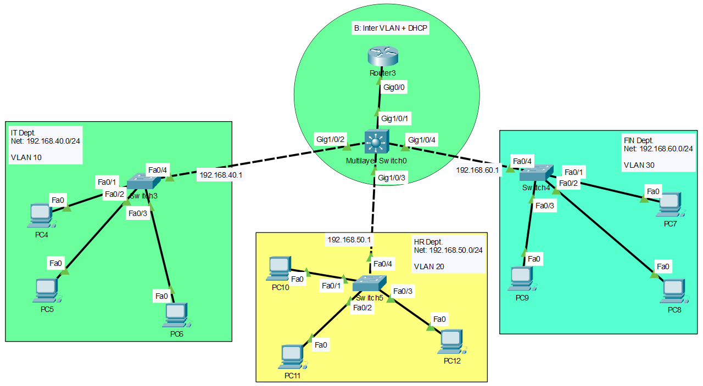

# Network B: VLANs, Inter-VLAN Routing and DHCP (Cisco Packet Tracer)

A campus network with three departments, each in its own VLAN. A multilayer switch carries all VLANs on trunk links to one router. The router routes between the VLANs (router-on-a-stick) and also acts as the DHCP server.

This is a standalone lab and the second half of the [integrated enterprise network](../README.md).



## Key points

1. **Router3 holds the VLAN gateways.** The multilayer switch only carries trunks. It has no `ip routing` and no SVIs.
2. **Access ports vs trunk ports.** `Fa0/1-3` on each department switch are access ports (one VLAN). `Fa0/4` and the multilayer switch's `Gig1/0/1-4` are trunks (all VLANs).
3. **The number in `encapsulation dot1Q` must match the VLAN ID.** One subinterface per VLAN, and its IP address is that VLAN's gateway.
4. **The VLANs must exist on every switch** that carries them (department switch and multilayer switch).
5. **DHCP:** `.1` to `.10` are excluded from each pool, and `default-router` is the VLAN's subinterface address.
6. **DNS in this standalone lab is a placeholder.** Router3 runs no DNS. When Network B joins Network A, the `dns-server` lines change to `172.16.0.3` (see the [integration steps](../README.md#integration-steps)).
7. **Run `write` on every device** after configuring it.

## How it works

1. **VLANs:** each department switch puts its PC ports in one VLAN, so the departments are separate broadcast domains.
2. **Trunks:** the uplink (`Fa0/4`) and the multilayer switch ports carry every VLAN, with each frame tagged by its VLAN ID (802.1Q).
3. **Router-on-a-stick:** Router3's single physical port `Gig0/0` is split into subinterfaces, one per VLAN. Each subinterface reads the tag and acts as that VLAN's gateway.
4. **DHCP:** a PC's broadcast stays in its VLAN, reaches Router3 over the trunk, and the matching pool answers with an address, gateway and DNS.
5. **Inter-VLAN traffic:** an IT PC pinging an HR PC sends the packet to its gateway `192.168.40.1`. Router3 routes it out the `.50` subinterface tagged VLAN 20, and the switches deliver it to the HR PC.

## Topology

```text
                         Router3
                            | Gig0/0
                    Multilayer Switch0
              Gig1/0/2     Gig1/0/3     Gig1/0/4
                 |            |            |
             Switch3       Switch5       Switch4
            IT VLAN 10    HR VLAN 20    FIN VLAN 30
          192.168.40.0/24 192.168.50.0/24 192.168.60.0/24
```

## Connections

| From | To |
| --- | --- |
| Router3 Gig0/0 | Multilayer Switch0 Gig1/0/1 |
| Multilayer Switch0 Gig1/0/2 | Switch3 Fa0/4 |
| Multilayer Switch0 Gig1/0/3 | Switch5 Fa0/4 |
| Multilayer Switch0 Gig1/0/4 | Switch4 Fa0/4 |
| Switch3 Fa0/1, Fa0/2, Fa0/3 | PC4, PC5, PC6 (IT) |
| Switch5 Fa0/1, Fa0/2, Fa0/3 | PC10, PC11, PC12 (HR) |
| Switch4 Fa0/1, Fa0/2, Fa0/3 | PC7, PC8, PC9 (FIN) |

## Addressing

| Department | VLAN | Network | Gateway (Router3) |
| --- | --- | --- | --- |
| IT | 10 | 192.168.40.0/24 | 192.168.40.1 |
| HR | 20 | 192.168.50.0/24 | 192.168.50.1 |
| FIN | 30 | 192.168.60.0/24 | 192.168.60.1 |

All PCs use **DHCP**.

## Build steps

### Step 1: Place devices and connect them

Use the connections table and set every PC to DHCP.

### Step 2: Configure the department switches

Run on **Switch3 (IT)**. Repeat on **Switch5** with `vlan 20` / `HR` and on **Switch4** with `vlan 30` / `FIN`.

```text
en
conf t
! Create the VLAN
vlan 10
name IT
exit
! PC ports: access ports in that VLAN
interface range fa0/1-3
switchport mode access
switchport access vlan 10
exit
! Uplink: trunk, carries all VLANs
interface fa0/4
switchport mode trunk
exit
do write
```

Verify on each switch: `do show vlan brief` and `do show interfaces trunk`.

### Step 3: Configure the multilayer switch (Switch0)

```text
en
conf t
! Create all VLANs so they can pass through
vlan 10
name IT
vlan 20
name HR
vlan 30
name FIN
exit
! All four ports are trunks (Router3 and the three switches)
interface range gig1/0/1-4
switchport mode trunk
exit
do write
```

Verify: `do show vlan brief` and `do show interfaces trunk`.

### Step 4: Configure Router3 (inter-VLAN routing)

```text
en
conf t
! Bring the physical port up (no IP address on it)
int gig0/0
no shut
exit
! One subinterface per VLAN: the dot1Q number is the VLAN ID,
! the IP address is that VLAN's gateway
int gig0/0.10
encapsulation dot1Q 10
ip address 192.168.40.1 255.255.255.0
exit
int gig0/0.20
encapsulation dot1Q 20
ip address 192.168.50.1 255.255.255.0
exit
int gig0/0.30
encapsulation dot1Q 30
ip address 192.168.60.1 255.255.255.0
exit
do write
```

Verify that all three subinterfaces are `up / up`: `do show ip interface brief`.

### Step 5: Configure DHCP on Router3

```text
! Keep .1 to .10 out of the pools (gateway and static devices)
ip dhcp excluded-address 192.168.40.1 192.168.40.10
ip dhcp excluded-address 192.168.50.1 192.168.50.10
ip dhcp excluded-address 192.168.60.1 192.168.60.10

! Turn the DHCP service on and create one pool per VLAN
service dhcp
ip dhcp pool IT-Pool
network 192.168.40.0 255.255.255.0
default-router 192.168.40.1
dns-server 192.168.40.1
exit
ip dhcp pool HR-Pool
network 192.168.50.0 255.255.255.0
default-router 192.168.50.1
dns-server 192.168.50.1
exit
ip dhcp pool FIN-Pool
network 192.168.60.0 255.255.255.0
default-router 192.168.60.1
dns-server 192.168.60.1
exit
do write
```

Verify: `do show ip dhcp pool`, `do show ip dhcp binding` and `do show running-config`.

## Verification

| Test | Command or action | Expected result |
| --- | --- | --- |
| VLANs | `show vlan brief` on each switch | VLAN 10, 20 or 30 with ports Fa0/1 to Fa0/3 |
| Trunks | `show interfaces trunk` on Switch0 | Gig1/0/1 to Gig1/0/4 trunking |
| Gateways | `show ip interface brief` on Router3 | Three subinterfaces `up / up` |
| DHCP | A PC's IP Configuration | Address from its VLAN's range, correct gateway |
| Leases | `show ip dhcp binding` on Router3 | One entry per PC |
| Same VLAN | Ping between two PCs in one department | Replies |
| Inter-VLAN routing | Ping from an IT PC to an HR PC, then a FIN PC | Replies (the first ping can time out while ARP completes) |

## Troubleshooting

- **A PC gets `169.254.x.x`:** DHCP is not reaching it. Check its port's VLAN and the trunk links.
- **Pings between VLANs fail:** check the subinterfaces are `up / up` and that each `encapsulation dot1Q` number matches its VLAN ID.
